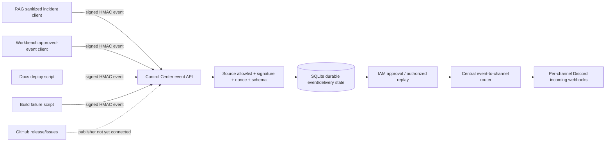

# Discord multichannel integration v1 — audit and readiness

Audit date: 2026-10-24. No live Discord request, credential change, secret
rotation, deployment, or production message was performed during this work.

## Current architecture and root cause

Discord delivery was not a multichannel integration. It was several direct,
best-effort incoming-webhook clients sharing one of two environment variables:

- `DISCORD_ALERT_WEBHOOK_URL` is used by control-center high-severity known
  issues and the ecosystem build failure script. This is the only Discord key
  populated in the active Studio `.env` (presence checked without printing its
  value), making it the publisher path consistent with observed messages in
  `#omnibioai-alerts`.
- `DISCORD_WEBHOOK_URL` is passed by Compose to Workbench, RAG, and Control
  Center for pipeline/user, RAG query, GPU/disk/service-down, and documentation
  deployment notifications. It is absent from the active Studio `.env`.
- The documentation deploy has a separate `.env.deploy` contract; that file is
  absent in this checkout.
- Workbench and RAG contain their own copies of a Discord helper. The control
  center also had a helper, and two shell scripts build webhook payloads
  independently. These clients did not inspect non-2xx responses.
- No Discord bot token, channel ID, per-channel webhook map, event routing
  table, or Discord publisher in any of the 71 discovered GitHub Actions was
  found. No code evidence of Discord gateway/event subscriptions was found.

The evidenced root cause is therefore missing architecture and configuration,
not simply an inference from quiet channels: there was no event-to-channel
router and no credential/configuration for the other channels. A second,
non-exclusive reason for an empty channel can still be that no qualifying
event occurred. Historical delivery success/failure cannot be reconstructed:
the old clients swallowed exceptions and treated Discord 4xx/5xx responses as
success, and no retained log containing a Discord delivery failure was found.

## Channel configuration and delivery status

“Configured” below means local credential presence only. It does not assert a
live Discord channel association or permission because no live request was
authorized.

| Channel | Automation policy | Current configuration | Live delivery |
|---|---|---|---|
| `general` | Community-driven | Intentionally none | Not verified |
| `announcements` | Releases and milestones | Missing | Not verified |
| `research-chat` | Community-driven | Intentionally none | Not verified |
| `show-and-tell` | Community-driven | Intentionally none | Not verified |
| `bug-reports` | Confirmed/resolved GitHub issues | Missing | Not verified |
| `feature-requests` | Accepted feature requests | Missing | Not verified |
| `support` | Support incidents/resolutions | Missing | Not verified |
| `tutorials` | Documentation/video publications | Missing | Not verified |
| `omnibioai-alerts` | Infrastructure/security alerts | Legacy webhook present | Not verified |

Configured credential count: **1/9**. Automated route definitions cover all
12 event types and only the six intended automation channels. The twelfth is
the sanitized, human-approved `github.workflow.failed` alert route.

## Implemented changes

The existing control-center Discord notifier was extended rather than adding a
second service:

- Exact event routing with no routes for `general`, `research-chat`, or
  `show-and-tell`.
- Secret JSON configuration (`DISCORD_CHANNEL_WEBHOOKS`) with strict HTTPS
  Discord-host/path validation, rejection of unknown/community-driven targets,
  and a migration fallback from `DISCORD_ALERT_WEBHOOK_URL` for alerts only.
- A required explicit `approved=True` plus `visibility="public"` gate. Unknown,
  unapproved, and private events are filtered before network access.
- Persistent SQLite event-ID claims for idempotency, including concurrent and
  process-restart protection.
- Four bounded attempts by default, exponential backoff, and `Retry-After`
  handling for HTTP 429. Connection-establishment failures are retried; 5xx
  responses and ambiguous timeout/network failures are recorded as unknown and
  are not automatically retried.
- A mode-0600 JSONL dead-letter file containing delivery metadata and a payload
  hash, but no webhook or message body.
- Per-channel Prometheus delivery/retry counters on the existing `/metrics`
  endpoint and credential-free channel status on `/integrations`.
- Discord title/embed/field/total-size enforcement, a 25-field cap, disabled
  allowed mentions, and neutralization of mass/user/role/channel mention text.
- Structured metadata-only logs, webhook URL redaction, and constrained event
  IDs to prevent log injection or accidental secret logging.
- Compose wiring to a persistent state directory and secret-free example
  configuration in both Studio compose variants.

Incoming webhooks are the least-privilege delivery mechanism here: each secret
can only post into its configured channel. No broad bot token or read/history
permissions are introduced. If bot delivery replaces webhooks later, it should
receive only View Channel and Send Messages in the six automated targets, with
no administrator, membership, moderation, history, or mention-everyone grants.

## Test evidence

The isolated mocked suite covers every event route, cross-channel leakage,
all nine configuration statuses, invalid/missing/revoked configuration, HTTP
401/403/429/5xx, bounded backoff, dead letters, restart-safe deduplication,
event filtering, explicit approval, secret redaction, mention suppression, and
Discord length limits. Result: **25 passed**. The legacy notifier tests are
included in that count. An additional **76 existing GPU, known-issue, and
uptime regression tests passed**, for 101 passing tests in the executable
targeted set.

Compose validation passed for the active Studio file. Validation of the
`studio-main` compose variant is blocked by an unrelated required TES variable
that is absent from its example environment. Python compilation was checked
with an external bytecode cache because a pre-existing source `__pycache__` is
not writable in this workspace. The full FastAPI integration-route suite could
not run because the host's project environment is incomplete (the base
interpreter lacks FastAPI and the partial local environment lacks Sentry and
pytest), and the existing control-center container is not running. The route
function was imported with the available FastAPI packages and directly verified
for channel status and secret omission; the full TestClient case is also
committed for the normal project environment.

## Remaining blockers and deployment readiness

Production is **not ready**. An authorized operator must create or verify one
least-privilege incoming webhook for each of the six automated channels, store
them in the deployment secret manager as `DISCORD_CHANNEL_WEBHOOKS`, and verify
their channel associations without disclosing values. Trusted source adapters
must then emit stable IDs and set approval only after the relevant release,
issue, feature, support, documentation, video, infrastructure, or security
approval workflow completes. Legacy RAG/Workbench/shell publishers should be
migrated in separate service-owned changes; their existing events do not map
cleanly to the requested public community taxonomy and may contain PII or
internal operational detail.

After configuration, run one authorized canary per automated route, verify the
channel, metrics, idempotency replay, and DLQ alerting, then deploy. Live
delivery remains intentionally unverified until that approval is given.

## V3 production-closure addendum (2026-10-24)

This addendum supersedes the V1 “legacy publishers should be migrated” status
where noted below; the V1 architecture and baseline test evidence remain useful.
No production resources, credentials, deployment state, or Discord messages
were changed.

### Current architecture

The router handles exactly these mappings: `platform.release` and
`platform.milestone` → `announcements`; `github.issue.confirmed` and
`github.issue.resolved` → `bug-reports`; `feature.request.accepted` →
`feature-requests`; `support.incident` and `support.resolved` → `support`;
`documentation.published` and `video.published` → `tutorials`;
`infrastructure.alert` and `security.alert` → `omnibioai-alerts`. `general`,
`research-chat`, and `show-and-tell` intentionally have no automated route.
Source ingress is authenticated with HMAC-SHA256 plus timestamp and nonce, not
IAM; IAM protects operator approval, listing, and replay only.

| Channel | Responsibility | Automated route | Credential status in local Studio config |
|---|---|---:|---|
| announcements | Approved releases/milestones | Yes | Missing |
| bug-reports | Confirmed/resolved public bugs | Yes | Missing |
| feature-requests | Accepted public requests | Yes | Missing |
| support | Sanitized public incidents/resolutions | Yes | Missing |
| tutorials | Published docs/tutorials/videos | Yes | Missing |
| omnibioai-alerts | Operational/sanitized security alerts | Yes | Legacy alert key present; channel association unverified |
| general | Community discussion | No | Not required |
| research-chat | Community discussion | No | Not required |
| show-and-tell | Community sharing | No | Not required |

The local secret-presence audit found only `DISCORD_ALERT_WEBHOOK_URL` set.
`DISCORD_CHANNEL_WEBHOOKS` and the seven source HMAC keys are absent. This is
presence-only evidence; values were never printed, and the legacy webhook’s
actual channel and permission cannot be asserted without a Discord canary.

### Event-source and publisher migration inventory

| Repository/source | Event(s) | Destination | Authentication / behavior | Migration status |
|---|---|---|---|---|
| Control Center event API | All 11 types | Fixed router table | HMAC source key, timestamp, nonce, schema, exact channel | Implemented; route suite passes |
| RAG | Sanitized support incident/resolution; approved docs hook | `support` / `tutorials` | Per-source HMAC client; no query, prompt, dataset, tenant, user, or PHI payload | Code migrated; no source key configured, tests environment-blocked |
| Workbench | Explicit approved release or sanitized service incident | `announcements` / `support` | Per-source HMAC client; user/workflow notification tasks remain non-public no-ops | Code migrated; no source key configured, tests environment-blocked |
| Docs deploy script | Successful public docs deployment; sanitized failure | `tutorials` / `omnibioai-alerts` | Central CLI client; stable commit ID; legacy fallback only when central config absent | Code migrated; deployment secret contract unconfigured |
| Ecosystem build script | Sanitized build failure | `omnibioai-alerts` | Central CLI client, legacy alert fallback only when central config absent | Code migrated; host source credentials absent |
| GitHub Releases | `release.published` → `platform.release` | Announcements | Minimal-permission GitHub Actions workflow; signed central CLI event; not pre-approved | Adapter added; requires repository URL/source secret and Control Center operator approval |
| GitHub issues/milestones/features | Milestones, confirmed/resolved issues, accepted features | Announcements/bug reports/features | No verified publisher workflow for reviewed labels/milestones/features | Not connected; review/approval workflow still needed |
| Support/feature intake | Public incidents, resolutions, accepted features | Support/feature-requests | No verified source service/workflow found | Not connected; source does not exist in inspected integration |
| Video publication | Approved public video | Tutorials | No verified post-publication publisher callback found | Not connected; publication boundary must be wired |
| Infrastructure/security monitoring | Sanitized infrastructure/security alerts | Alerts | Build-failure adapter exists; no general monitoring/security event adapter verified | Partial; monitoring adapters and sanitization policy remain |
| Direct Control Center alert | Existing high-severity known issue | Alerts | Legacy alert webhook preserved | Preserved; no live receipt evidence |

Central durable event state, IAM approval/replay APIs, signed-source
authentication, stable event identity, source/event allowlisting, replay nonce
protection, schema/channel checks, PII/sensitive-field rejection, and receipt
records are implemented. Self-approval is disabled by default. An operator may
enable a source/event approval policy only when a separate editorial approval
step is enforced at that source; internal event generation alone is not
approval. The Control Center API and router never expose webhook values.

### Provisioning contract and recovery

Use the existing deployment secret manager; do not put values in Git or logs.
Provision one webhook per automated channel into `DISCORD_CHANNEL_WEBHOOKS`
(JSON object keyed by exact channel names), retaining
`DISCORD_ALERT_WEBHOOK_URL` until the alert route is canary-verified. Five
new channel webhooks are missing: `announcements`, `bug-reports`,
`feature-requests`, `support`, and `tutorials`. Add a distinct random HMAC
secret (at least 32 characters) for each configured source under
`DISCORD_EVENT_GITHUB_SECRET`, `_RAG_SECRET`, `_WORKBENCH_SECRET`,
`_DOCUMENTATION_SECRET`, `_VIDEO_SECRET`, `_INFRASTRUCTURE_SECRET`, and
`_SUPPORT_SECRET`; Control Center receives verifier keys, and each producer
receives only its own. No values are included in this document.

On a Discord delivery failure, inspect the credential-free event status and
per-channel metrics, verify the destination mapping, then use the IAM-protected
replay endpoint after correcting the cause. Do not edit SQLite files manually.
Retries are bounded and rate-limit-aware; permanent HTTP errors are not retried
indefinitely. Stable IDs suppress duplicates. Legacy alert fallbacks are used
only when central routing is not configured; when central routing is configured
but errors/timeouts, the scripts avoid legacy fallback because the event may
already have been durably accepted.

### V3 verification and release gates

- Central routing/auth/store/client mocked tests: **35 passed** (25 V1 routing
  tests plus 10 V3 source/auth/store/client tests).
- Control Center complete backend regression: **blocked at collection**; the
  host lacks FastAPI and multiple other declared dependencies (60 test modules
  could not collect). The normal project pytest configuration also references
  an unavailable coverage plugin. Do not treat this as a Discord test failure
  or as a pass.
- RAG suite: **2 passed, 8 blocked** because pytest async support is absent.
- Workbench Discord tests: **8 blocked** during Django setup because
  `python-dotenv` is absent.
- Active Studio Compose configuration: **passed** (`docker compose config -q`).
  `studio-main` validation is blocked by absent local Compose override/secrets
  files; example-only validation also requires deployment variables.
- Shell syntax and Python source compilation: run with output directed to a
  writable cache; see V3 closure evidence. No live Discord request was sent.
- DGX service/image provenance, secret-manager configuration, migrations in
  deployment, rollback, six live canaries, and explicit deployment approval:
  **not verified**.

Deployment manifest (prepared, not applied): deploy the Control Center image
containing the central event API and the matching Compose file; bind the
existing persistent Discord state directory; inject the six webhook map plus
only the required source HMAC keys through the authorized secret manager; set
approval-source policy only after source editorial approvals are independently
enforced; deploy source-client images/scripts; run migrations as a reviewed
deployment step; then run the six authorized test canaries. Do not run this
manifest until source-image provenance, database backup, and deployment
approval are verified.

Rollback: stop event producers first; restore the prior Control Center image
and Compose configuration; retain (do not delete) the shared SQLite state and
dead-letter records; re-enable the previously working alerts path only where
the operator confirms it cannot create duplicate posts; check service health
and the old known-issue alert. No migration is destructive, but an actual
rollback was not executed or validated in production.

The readiness percentages in the closure report use these explicit
denominators: production gates = met release gates / 12; software completion =
implemented-and-tested software checklist items / 10 (routing, all mappings,
durable dedupe, bounded retries/rate limits, DLQ/replay, source auth/schema,
approval boundary, safe message/log handling, source integrations, operational
observability); channel configuration = locally present credentials / 6;
test execution = executed test cases / planned scoped test cases, with the
pass percentage reported separately among executed tests; live acceptance =
verified channel canaries / 6. Blocked and unexecuted tests are excluded from
the pass numerator.

V3 qualification: router and mappings are implemented, but production closure
is **NO-GO**. Five channel webhooks, all source keys, complete source publishers,
normal provisioned regression infrastructure, deployment evidence, rollback
validation, and authorized six-channel canaries remain outstanding. Software
implementation should not be confused with production qualification.

## V4 final production-closure qualification (2026-10-24)

This section supersedes V3 test-environment counts where fresh V4 checks ran.
The workspace contains multiple dirty repositories and unrelated pending work;
the source revisions inspected (not a deployment provenance claim) were
Control Center `f37ce8c`, RAG `9e7f6b6`, Workbench `79feb3da`, Docs `559ed48`,
and Studio `ec0772e7`. No changes were made to production services, databases,
or secret stores, and no live Discord messages were sent.

### Source and publisher inventory

The seven-source authentication contract is `github`, `rag`, `workbench`,
`documentation`, `video`, `infrastructure`, and `support`. The API has a
source/event allowlist and independently keyed HMAC authentication for all
seven. This is not equivalent to seven connected production publishers.

| Source family | Verified publisher path in this workspace | Current qualification |
|---|---|---|
| GitHub | Control Center `.github/workflows/discord-release-event.yml` and `scripts/publish_discord_event.py` | Published releases submit signed `platform.release`; remain pending central approval. Issue, milestone, and accepted-feature workflows are absent. |
| RAG | `omnibioai-rag/ragbio/api/server.py` and `ragbio/notifications/discord_events.py` | Sanitized service event client; source key absent. User/query and biomedical content remain excluded. |
| Workbench | `omnibioai-workbench/notifications/discord_events.py` | Signed client exists and isolated tests pass, but no event-producing caller was found; no connected source counted. |
| Documentation | `omnibioai-docs/scripts/deploy-docs.sh` | Publication/deploy notification client; deployment credential contract is not configured here. |
| Video | Source contract/client only | No verified post-publication callback or trusted workflow was found. External publication workflow is required. |
| Infrastructure | Ecosystem build failure script using the central CLI; Control Center alert path retained | Build failure path exists; general deployment monitoring and sanitized security feed are not connected. |
| Support | Source contract/client only | No trusted incident/ticket source or public-redaction approval workflow was found. Private tickets must not be bridged. |

Thus four source families have code paths (GitHub releases, RAG, docs, and
infrastructure build failures); Workbench code is not wired, and video/support
upstream publishers do not exist in the inspected services. Confirmed issue,
issue resolution, milestone, feature approval, generalized infrastructure,
security, support, and video events need trusted upstream workflows. The
release is therefore **4/7 connected**, not 7/7. Existing legacy paths are
classified as follows: RAG and docs are central-client migrated; Workbench's
user-specific notification path is intentionally not republished publicly;
the shell build-failure path is central-client migrated; and the existing
Control Center alert notifier remains a compatibility path. The fifth path is
not retired because there is no live replacement verification; migrating it
without the alert-channel mapping/credentials risks losing current alerts.

### Configuration and source-key contract

Presence-only inspection of the local Studio environment found
`DISCORD_ALERT_WEBHOOK_URL` present and `DISCORD_CHANNEL_WEBHOOKS` absent; no
current source key was present for any of the seven named sources. Values were
not printed. This supports **1/6 automated channel credentials present** only
as a legacy key; it does not prove the alert webhook points to the named
channel. The other five exact operator-created webhook entries are
`announcements`, `bug-reports`, `feature-requests`, `support`, and `tutorials`.
Create/store them in the existing deployment secret manager as one JSON object
under `DISCORD_CHANNEL_WEBHOOKS`, retaining the alert key until the alert route
is verified. Do not paste values into tickets, logs, this repository, or
workflow output. The three community channels remain recognized and have no
automated mapping.

The seven independent secret names are `DISCORD_EVENT_GITHUB_SECRET`,
`DISCORD_EVENT_RAG_SECRET`, `DISCORD_EVENT_WORKBENCH_SECRET`,
`DISCORD_EVENT_DOCUMENTATION_SECRET`, `DISCORD_EVENT_VIDEO_SECRET`,
`DISCORD_EVENT_INFRASTRUCTURE_SECRET`, and `DISCORD_EVENT_SUPPORT_SECRET`.
Each current key must be at least 43 URL-safe characters (32 bytes of entropy).
Generate with a cryptographically secure secret-manager generator; deliver
only each producer's own key and verifier key to the Control Center. Compose
maps each source-specific deployment key into the producer's
`DISCORD_EVENT_SOURCE_SECRET` variable; docs/shell publishers use the same
variable name in their isolated runtime. Never reuse one value across
producers. For
rotation, provision `DISCORD_EVENT_<SOURCE>_PREVIOUS_SECRET` temporarily,
deploy both verifier keys, rotate that source client, confirm signatures, then
remove the previous key. The loader also supports at most two keys per source
through `DISCORD_EVENT_SOURCE_SECRETS`. Do not generate or write keys from this
workspace; no authorized secret-writing capability was available.

### V4 reliability policy

Discord webhook POST does not provide a client idempotency key. Therefore an
HTTP timeout after transmission, a 5xx, or a process crash with a stale
`pending` delivery has an ambiguous outcome. The publisher records
`delivery_unknown`/`unknown`, writes metadata-only dead-letter information,
and does **not** retry automatically. The event API's stale `delivering` lease
is similarly converted to `delivery_unknown`. A local 2xx ledger receipt can
repair a crash between Discord acceptance and event-store receipt persistence.
Otherwise an authorized operator must verify channel visibility and reconcile
the central event as delivered or not delivered; only verified non-delivery
may be replayed with the IAM-protected `platform.manage_infra` operation. This
is at-least-once with an explicit ambiguity stop, not an exactly-once promise.
Safe connection-establishment failures and HTTP 429 remain bounded retries;
429 honors `Retry-After`. Permanent 4xx responses fail without blind retries.

The legacy `notify()` compatibility client now calls `raise_for_status()` and
logs a sanitized warning for non-2xx responses instead of silently treating
them as success. Its legacy signature still absorbs the exception to avoid
breaking existing callers; upstream callers do not receive a return receipt.

### V4 fresh test and host evidence

- Control Center Discord-focused tests: **49 passed** across notifier, routing,
  source/auth/store, crash-recovery, and client tests.
- RAG async Discord tests: **10/10 passed** using the optional declared test
  dependency and isolated pytest plugin.
- Workbench Discord tests: **8/8 passed** with an isolated test path that
  avoids the unrelated Django project-wide setup.
- Disposable in-process signature→durable pending approval→explicit approval
  →mock webhook delivery→duplicate suppression: **passed**. Its test IAM is
  not the production identity stack, and API route dispatch is not included.
- The full Control Center suite discovered 1,121 tests but collection stopped
  with **48 collection errors** (mostly absent `sentry_sdk`, plus `sqlalchemy`
  and `weasyprint`). Those tests are blocked, not passed. The local wheel cache
  did not contain those packages and network DNS was unavailable.
- Studio `docker compose config -q` passed for the active compose file.
  Workflow YAML parsed successfully. Host architecture reports `aarch64`, but
  Docker daemon inspection is blocked by permission denied on the Docker socket;
  image architecture/digest/source provenance and production configuration
  remain unverified. No privilege escalation or Docker permission change was
  attempted.
- No authorized live Discord approval/readback was available; **0/6 canaries**.
  No deployment or production change occurred. Rollback procedure is documented
  but was not executed in an isolated Docker stack or production.

### V4 gate decision

| Gate | Result | Evidence / blocker |
|---|---|---|
| G1 central router | PASS | Focused router tests and disposable mock flow. |
| G2 11 mappings | PASS | Route matrix tests pass; no community channel is routable. |
| G3 six webhook mappings | BLOCKED | Only the legacy alert key exists; actual channel identity unverified. |
| G4 seven authenticated publishers | BLOCKED | Four source families have code paths; three source integrations are absent/unwired, and zero of seven keys are configured. |
| G5 five legacy publishers | BLOCKED | Four of five classified/migrated or safely non-public; preserve existing Control Center alert path pending verified replacement. |
| G6 security | BLOCKED | HMAC, key isolation/rotation, schema, PII, destination, mention, and redaction unit tests pass; IAM approval/replay route authorization and deployment security boundary are not independently qualified. |
| G7 reliability | PASS (scoped) | Retry/rate-limit, DLQ, dedupe, concurrency, stale crash ambiguity, and local receipt recovery tests. |
| G8 full backend regression | BLOCKED | 48 dependency-related collection errors; 1,121 discovered tests are not a completed suite. |
| G9 ARM64 deployment/provenance | BLOCKED | Host is ARM64, Docker daemon access denied; no active image digest/commit provenance evidence. |
| G10 six live canaries | BLOCKED | No explicit live publication approval; 0/6 sent. |
| G11 isolated rollback | NOT VERIFIED | Runbook exists; no disposable Docker stack/rollback was available to execute. |
| G12 production approval | BLOCKED | No deployment authorization, and deployment is explicitly out of scope. |

Release gate completion is **3/12 (25.0%)**; only PASS gates count. Software
completion uses the prior 10-item rubric: router, all mappings, durable
dedupe, bounded retry/rate limits, DLQ/replay, source auth/schema, approval
boundary, safe formatting/logging, publisher ecosystem integration, and
operational observability. Seven pass, two (ecosystem integration and
observability/runtime qualification) are partial, and one (deployment
qualification/rollback) is blocked: **7/10 = 70% implementation complete**
under that rubric. Automated webhook configuration is **1/6 (16.7%)** on
presence-only evidence; connected trusted publishers are **4/7 (57.1%)**.
For the 67 fresh automated tests above (49+10+8), 67 passed and 0 failed; the
separate disposable script passed. The full backend run remains blocked and is
excluded from that focused pass percentage. Live acceptance is **0/6 (0%)**.

### Operator actions required for GO

1. Provision and validate six least-privilege webhooks and seven independent
   source keys in the authorized secret manager; confirm channel identity
   without exposing values.
2. Add trusted upstream approval/publisher workflows for GitHub issue,
   milestone, and feature decisions, Workbench operational events, public
   video releases, support incidents, and general infrastructure/security
   events; verify approvals are controlled by protected server-side state.
3. Complete five-path legacy retirement only after the remaining Control
   Center alert path has a verified central equivalent; keep fallback free of
   duplicate delivery.
4. Provision the backend's declared test dependencies and execute the full
   regression suite; inspect the DGX ARM64 image digest/configuration and
   database compatibility through authorized read-only host access.
5. Run disposable Docker E2E and rollback qualification; separately obtain
   explicit live-canary and production deployment approvals. Then verify all
   six destination channels by readback, not HTTP status alone.

Evidence records are summarized in `docs/evidence/discord-v4/`; hashes cover
the sanitized evidence files and exclude the hash manifest itself.

## V5 production-closure qualification (2026-10-24)

Fresh V5 evidence is recorded in `docs/evidence/discord-v5/qualification.md`.
The V4 results above remain historical; they are not substituted for V5 runs.
The core router still has all 11 fixed event mappings and recognizes all nine
channels. Only the six designated automated channels are routable; `general`,
`research-chat`, and `show-and-tell` remain community-only.

The source contract remains exactly seven identities: `github`, `rag`,
`workbench`, `documentation`, `video`, `infrastructure`, and `support`. Five
have connected code paths in this workspace. GitHub now submits sanitized,
unapproved public release, confirmed/resolved issue, accepted-feature, and
completed-milestone events using stable GitHub object IDs. Private repositories,
pull requests, drafts, prereleases, unreviewed issues, and issue text are
excluded. Release and community workflows pass YAML parsing; GitHub-hosted
workflow execution was not triggered. The video build workflow queues only
new public manifest entries with reviewed content hashes; its messages remain
pending central approval. RAG, docs deployment, and infrastructure build
failure sources retain their central signed-client behavior. The Workbench
client is present but no trusted event-producing caller was found. No support
incident source or public-redaction approval workflow was found. These are
external-source gaps, not grounds to fabricate events.

The five historical legacy paths remain 4/5 migrated or safely retired. RAG,
docs, the ecosystem build script, and Workbench's user-specific public
notification behavior use the central path or are intentionally non-public.
The existing Control Center alerts compatibility publisher is preserved and
not switched because the replacement alert channel cannot be destination-
verified without its channel mapping and live credentials.

Presence-only inspection of the active local Studio `.env` found the legacy
`DISCORD_ALERT_WEBHOOK_URL`; `DISCORD_CHANNEL_WEBHOOKS` and all seven
`DISCORD_EVENT_<SOURCE>_SECRET` values were absent. No values were read into
output. This is 1/6 secret entries present (not a verified channel mapping),
0/6 verified destination identities, and 0/7 source credentials. No usable
secret-manager CLI or authorized secret-write capability was available. The
host is ARM64, but Docker daemon access returns permission denied; source/image
digest, deployment config, persistence mount, production IAM routing, and
rollback remain unverified. No production resources were changed and no live
Discord message was sent.

Fresh focused tests passed: Control Center Discord router/client/event and
GitHub adapter tests **57/57**; RAG async Discord tests **10/10**; Workbench
Discord tests **8/8**; video publication tests **6/6**. The V4 disposable
in-process HMAC→persistence→approval→mock delivery→deduplication script was
rerun and passed. All 11 routes, including all six automation destinations,
are covered by the route test; the three community channels are asserted
community-only. YAML parsing passed for the release, GitHub community, and
video CI workflows; Python compilation and legacy shell syntax checks passed.
These do not qualify a complete disposable service stack or live delivery.

The provisioned Control Center Python 3.12 environment now collects **2,152**
backend tests without the prior V4 missing-package collection errors. Full
execution did not complete: it stalls on the first FastAPI `TestClient` request
in `test_analytics_router.py` under this environment and was terminated by a
bounded timeout. That is a runtime/test-harness blocker; the suite is not
reported as passed. The focused suites are not a substitute for this regression.

V5 gate decision: G1 PASS; G2 PASS; G3 BLOCKED; G4 BLOCKED; G5 BLOCKED; G6
BLOCKED (mocked signature/schema checks pass, but IAM route dispatch and runtime
identity isolation are not verified); G7 BLOCKED (focused retry/DLQ/idempotency
and crash-ambiguity tests pass, but the full restart/fault matrix is not
qualified as an isolated service stack); G8 BLOCKED; G9 BLOCKED; G10 BLOCKED;
G11 NOT_VERIFIED; G12 BLOCKED. Therefore **2/12 gates pass (16.7%)**.
Software implementation is **21/24 = 87.5%** on the explicit rubric of 11
event mappings + 7 connected source adapters + 5 legacy paths + 1 central
router: 11 mappings, 5 connected adapters, 4 migrated/retired paths, and the
router are verified. Channel credential presence is **1/6 = 16.7%**, channel
identity verification **0/6**, source credentials **0/7**, and live canaries
**0/6**. Overall production readiness is **NO-GO**.

Operator actions required before GO:

1. In the authorized Discord/secret-management workflow, create one webhook
   for each of `announcements`, `bug-reports`, `feature-requests`, `support`,
   `tutorials`, and `omnibioai-alerts`; set the six-entry
   `DISCORD_CHANNEL_WEBHOOKS` JSON secret, preserving the legacy alert key
   until the `omnibioai-alerts` destination is verified. Confirm each webhook
   is in the intended server/channel, without disclosing its value.
2. Provision seven independent high-entropy source keys in the secret manager:
   `DISCORD_EVENT_GITHUB_SECRET`, `DISCORD_EVENT_RAG_SECRET`,
   `DISCORD_EVENT_WORKBENCH_SECRET`, `DISCORD_EVENT_DOCUMENTATION_SECRET`,
   `DISCORD_EVENT_VIDEO_SECRET`, `DISCORD_EVENT_INFRASTRUCTURE_SECRET`, and
   `DISCORD_EVENT_SUPPORT_SECRET`. Keep source-specific keys isolated.
3. Connect a real approved Workbench event producer and a trusted, sanitized
   support incident/resolution producer; establish the broader infrastructure
   and security feed if those event types are required operationally.
4. Run full backend tests in a supported host/runtime where FastAPI
   `TestClient` dispatch completes; exercise the real IAM route stack, then
   run isolated six-channel E2E and rollback qualification.
5. Through authorized DGX read-only access, verify the ARM64 image digest and
   source provenance, active configuration, secrets references, and persistent
   queue. Obtain explicit approval for six synthetic live canaries; verify
   destination visibility/readback. Production deployment requires separate
   explicit authorization and is not performed by this workstream.

Do not treat pending approval events as publication authorization, mocked
Discord delivery as live acceptance, or successful webhook HTTP status as
proof of the visible channel destination.

## V6 qualification addendum (2026-10-24)

V6 adds safe, operator-triggered Workbench and support source paths. The
Workbench Celery task now accepts only a stable event ID, an allowlisted event
kind (`platform.release`, `support.incident`, or `support.resolved`), and a
correlation ID; message text is fixed by the client and the source can never
assert publication approval. The CLI at
`omnibioai-workbench/scripts/publish_workbench_discord_event.py` uses the same
contract and propagates rejection. Workbench user/pipeline notifications
remain non-public. The ecosystem currently has no authoritative support
ticketing service, so `scripts/publish_support_discord_event.py` is a
fixed-template operator publisher for public, sanitized incident/resolution
notices. It requires an operator redaction attestation and always creates a
pending event; Control Center IAM approval is still required. Neither command
fabricates an incident or stores private ticket details.

The seven code-level source identities are now represented by authenticated
adapters: `github`, `rag`, `workbench`, `documentation`, `video`,
`infrastructure`, and `support`. This is implementation completeness only.
The active local Studio configuration still has just the legacy alerts
credential; no channel map or source HMAC keys are configured. No channel
destination identity can therefore be verified. The old Control Center
`notify()` direct alerts path remains intentionally active for compatibility;
changing it before central route credentials, destination identity, and
end-to-end alert acceptance are available could lose operational alerts. It is
the remaining fifth legacy publisher migration.

The prior `TestClient` stall was reproduced in a minimal FastAPI application
and traced to the restricted host's default asyncio selector not waking after
an AnyIO worker-thread callback. The backend test configuration now selects
uvloop where installed, matching the supported `uvicorn[standard]` Linux
runtime. Lifespan and thread offloading remain enabled. Full backend test
execution completed with 2,158 tests passing and 72 subtests passing. The
repository's configured pytest coverage gate still exits nonzero: measured
coverage was 96.59%, below the backend threshold of 98%; the threshold was
not lowered. Local health-check tests required loopback permission, and
report tests required the declared pandas dependency installed only in an
isolated `/tmp` virtual environment.

Fresh V6 checks also passed: Control Center Discord-focused suite **59/59**;
route-level IAM/API and subprocess crash-recovery suite **6/6**; Workbench
publisher suite **14/14**; RAG Discord suite **10/10**; and video publication
suite **6/6**. The disposable mock pipeline now exercises all six automated
channels and excludes all three community channels (**6/6 routes, 3/3
exclusions**). It is an in-process pipeline test, not the requested disposable
service stack. No live Discord message was sent. Docker daemon access is
denied, so ARM64 image provenance, deployment settings, and isolated rollback
remain unverified.

V6 gate status: G1 PASS; G2 PASS; G3 BLOCKED; G4 BLOCKED (adapters exist, but
0/7 signing credentials); G5 BLOCKED (4/5 legacy paths migrated); G6 PASS
(isolated API IAM and security tests); G7 NOT_VERIFIED (the subprocess crash
case and component fault tests pass, but the complete service crash matrix is
not qualified); G8 FAIL (all tests passed, configured 98% coverage gate did
not); G9 BLOCKED; G10 BLOCKED; G11 BLOCKED; G12 BLOCKED. **3/12 gates pass**.
Software implementation is **23/24 = 95.8%**, using the explicit rubric of 11
event mappings + 7 source adapters + 5 legacy publisher paths + central
router. Channel secret presence is **1/6**, verified destination identities
**0/6**, community exclusions **3/3**, source signing credentials **0/7**,
and live canaries **0/6**. Production remains **NO-GO** and unchanged.

Operator actions to close production qualification:

1. In Discord and the authorized secret manager, provision six distinct
   webhooks for `announcements`, `bug-reports`, `feature-requests`, `support`,
   `tutorials`, and `omnibioai-alerts`; verify server/channel identity and set
   `DISCORD_CHANNEL_WEBHOOKS`. Keep `DISCORD_ALERT_WEBHOOK_URL` until its
   replacement is independently verified.
2. Provision seven independent high-entropy HMAC secrets under
   `DISCORD_EVENT_GITHUB_SECRET`, `DISCORD_EVENT_RAG_SECRET`,
   `DISCORD_EVENT_WORKBENCH_SECRET`, `DISCORD_EVENT_DOCUMENTATION_SECRET`,
   `DISCORD_EVENT_VIDEO_SECRET`, `DISCORD_EVENT_INFRASTRUCTURE_SECRET`, and
   `DISCORD_EVENT_SUPPORT_SECRET`. Do not copy one source key across identities.
3. Migrate or explicitly retain the Control Center legacy alerts publisher
   only after the central alerts destination is verifiable; establish an
   authoritative support-system trigger if one is introduced.
4. Add tests for the remaining backend coverage gaps or adjust implementation
   to meet the existing 98% coverage policy without weakening it; then rerun
   the normal suite.
5. Grant authorized read-only DGX Docker access to verify immutable ARM64
   image digest/source provenance, compose and secret references, and
   persistence. Run the disposable service stack and isolated rollback.
6. Obtain explicit operator approval before six labeled live canaries. Verify
   each actual destination with authorized read access. Production deployment
   requires separate approval and is not performed by this workstream.

## V7 engineering closure update (2026-10-24)

This update supersedes prior implementation and test counts only where
explicitly stated. It does not change credentials, Discord, deployment state,
or production services. V6 remains historical evidence; fresh V7 evidence is
in `docs/evidence/discord-v7/qualification.md`.

### Final legacy alert path

The fifth legacy publisher is the Control Center `notify()` path used by
high-severity known-issue, GPU, disk, and runner checks. When both
`DISCORD_EVENT_ROUTER_URL` and the infrastructure source signing key are
configured, it submits a fixed, sanitized `infrastructure.alert` envelope to
the central signed event API with a stable event ID. The event is unapproved
by default and waits for operator approval. Central submission failures never
fall back to a direct webhook, avoiding duplicate public delivery after an
ambiguous response. When central routing is absent, the existing direct
webhook remains as a compatibility path; `DISCORD_ALERT_WEBHOOK_URL` is
preserved. The software migration is implemented and mock-tested, but
production routing equivalence is not claimed until the central endpoint and
key are configured and an authorized channel canary is verified.

Known-issue records created before UUID IDs were introduced remain supported:
the alert path derives a deterministic event key from title and opened-at if
the record has no ID. Records with IDs continue to use those IDs.

### V7 qualification result

The full Control Center backend suite completed with **2,224 passed, 0 failed,
599 warnings, and 72 subtests passed**. The existing coverage threshold was
not changed. Coverage is **98.01% (8,947/9,129 statements)**, so the normal
coverage-enforced regression command passes. Discord publisher and event-store
modules measure 100% line coverage. RAG Discord tests passed 10/10, Workbench
Discord tests 14/14, Videos publication tests 6/6, and focused Control Center
Discord/API/source tests passed. The six-channel mocked event flow passed; it
is not a live Discord test or a Docker-backed service-stack qualification.
Three SQLite subprocess crash tests cover termination before persistence,
after a durable claim but before HTTP submission, and after mocked remote
acceptance. Restart delivers the unpersisted event but does not blindly retry
the two ambiguous persisted cases. The full multi-point crash matrix remains
unverified.

### Current operator configuration and release blockers

Presence-only inspection of the active Studio `.env` found
`DISCORD_ALERT_WEBHOOK_URL`; it did not find `DISCORD_CHANNEL_WEBHOOKS` or any
of the seven source keys. No webhook values were printed. Therefore one legacy
alert credential is present, but **zero of six channel identities are
verified**, and source credentials are **0/7**. A webhook variable alone is
not proof of server/channel identity or permissions. Provision distinct
webhooks for `announcements`, `bug-reports`, `feature-requests`, `support`,
`tutorials`, and `omnibioai-alerts` in `DISCORD_CHANNEL_WEBHOOKS`, preserving
`DISCORD_ALERT_WEBHOOK_URL` until the alerts replacement is verified. Keep
`general`, `research-chat`, and `show-and-tell` out of the webhook map.

Configure independent keys for `DISCORD_EVENT_GITHUB_SECRET`,
`DISCORD_EVENT_RAG_SECRET`, `DISCORD_EVENT_WORKBENCH_SECRET`,
`DISCORD_EVENT_DOCUMENTATION_SECRET`, `DISCORD_EVENT_VIDEO_SECRET`,
`DISCORD_EVENT_INFRASTRUCTURE_SECRET`, and `DISCORD_EVENT_SUPPORT_SECRET`.
Each producer receives only its own key. Use the existing secret manager and
rotation overlap contract; no key material is included here.

The host architecture reports `aarch64`, but the configured Docker context
cannot access `/var/run/docker.sock`; no AWS CLI/secret-manager client is
available in this workspace. Image digest/provenance, active deployment
configuration, Docker-backed end-to-end behavior, and isolated rollback are
not verified. No live Discord canary or production deployment was authorized
or performed. Production remains **NO-GO**.

## V8 infrastructure and live-acceptance update (2026-10-24)

V7 remains the accepted software baseline; this update qualifies available
infrastructure without changing production. Fresh V8 evidence is in
`docs/evidence/discord-v8/qualification.md`. The checksummed V7 evidence was
verified before V8 work.

The new `scripts/qualify_discord_v8.py` defaults to bounded, read-only Docker
inventory. It never reads container environment variables and reports only
allowlisted image metadata. On this host it reports `aarch64`, Docker context
`default`, and a permission-denied Docker daemon; it correctly exits nonzero
and leaves image provenance unverified. Its `--mode isolated-tests` runs the
coverage-enforced backend suite and in-process mock flow, but is explicitly
not Docker service E2E or live acceptance. Do not change Docker socket
permissions to use it; an authorized host operator must run the inventory.

Fresh V8 test results: Control Center 2,224 passed, zero failed, 601 warnings,
72 subtests; statement coverage 98.01% (8,947/9,129), passing the existing
98% threshold. RAG Discord tests passed 10/10, Workbench 14/14, and Videos
publication tests 6/6. The mocked event flow passed all six automated routes
and excluded all three community channels. These results do not verify
production credentials, channel identity, Docker E2E, live delivery, or the
full crash matrix. Three V7 subprocess crash cases remain the only process
qualification; V8's 18-case crash matrix is not verified.

The first sandbox-restricted backend runner could not use loopback sockets;
that attempt was not counted as a pass. The same full suite was rerun with
authorized local loopback test access and passed as reported above.

The six-channel presence count remains 1/6 solely because the legacy alert
variable exists in the authorized local configuration; its actual channel is
unverified. No channel destination identity is verified (0/6). Production
source credentials remain 0/7. Do not interpret mocked source contract tests
as runtime configuration. GitHub secret metadata could not be inspected due
to unavailable network access, and no secret values were read or printed.

No live canary was sent, no production configuration was changed, and no
deployment was performed. Production remains **NO-GO**. See the V8 evidence
for gate statuses and the consolidated operator checklist.

## V9 final acceptance and gate closure (2026-10-24)

V9 records a fresh qualification of the current, dirty workspace candidate;
V8 regression and coverage results are historical and are not inherited as
current-candidate passes. The Control Center revision is
`f37ce8c952f917f607e9923cbb47dda8b0406a7a`; multiple integration/source files
are modified or untracked across the ecosystem repositories. The V9 evidence
is in `docs/evidence/discord-v9/qualification.md` with a SHA-256 manifest.

The fresh Control Center Discord-focused suite passed **109 tests**. Python
source verification passed for 272 files using the repository's verifier,
which excludes only the tracked `combined_control_center.py` concatenation
artifact; Bash syntax passed for the five checked CI scripts. The full current
backend regression and coverage could not be rerun: the configured virtualenv
lacks pytest, the available system Python lacks project dependencies and
pytest-cov, and the cross-repository test environments are incomplete. Thus
V8's 2,224/0 and 98.01% remain historical, not a fresh V9 result.

The host reports `aarch64`/`default` Docker context, but this session cannot
access the Docker daemon (permission denied). This does not establish the
DGX host's permissions outside this restricted session. No Discord admin,
webhook readback, or secret-manager provisioning access is available here.
Current evidence is 1/6 webhook-variable presence only, 0/6 verified channel
identities, 0/7 source credentials, and 0/7 real source runtimes. The
six-route mock is not disposable Docker E2E. The available process tests do
not cover the complete crash matrix. No live canary or deployment was
performed; production remains **NO-GO and unchanged**.

V9 gate status is G1 PASS, G2 PASS, G3 BLOCKED, G4 BLOCKED, G5 NOT_VERIFIED,
G6 NOT_VERIFIED, G7 NOT_VERIFIED, G8 NOT_VERIFIED, G9 BLOCKED, G10 BLOCKED,
G11 BLOCKED, and G12 BLOCKED (2/12 PASS). See the V9 qualification for the
evidence basis and the single consolidated operator checklist. Do not treat
historical V8 results as proof of this dirty candidate or as production
readiness.

## V10 release-candidate stabilization (2026-10-24)

V10 reconciles V2, V8, and V9 without combining their results. The recorded
repository HEADs match the prior V9 source commits, but the cross-repository
worktrees are still dirty and have different working-tree contents; Docs is
also three commits behind its upstream. The V8 2,224-pass/98.01% result is
historical, not a V10 regression result. V2's 112 focused passes and V9's 109
focused passes likewise refer to earlier worktree states.

V10 added duplicate webhook-ID rejection (including legacy alert aliasing),
rejects nonstandard/invalid webhook ports, and adds process tests for
mid-submit termination, retry-worker termination, concurrent SQLite claims,
and a locked database. The fresh focused Control Center Discord suite passed
**119 tests**; the process crash file passed **7 tests**; Videos publication
tests passed **6/6**. Python verification compiled 272 files (excluding only
the known tracked concatenation artifact), Bash syntax checks passed for the
docs/build/Control Center shell scripts, Studio Compose static validation
passed, and `git diff --check` passed.

Full regression is blocked, not passed: the project `.venv` has no pytest and
contains packages outside the backend constraints; the isolated pinned-extra
install could not resolve `pypi.org` in this network-restricted session.
RAG's async suite reported 2 pass and 8 plugin-blocked cases without
`pytest-asyncio`; Workbench test setup is blocked by absent `python-dotenv`
(the full requirements entry `dotenv` was corrected to `python-dotenv`, but
the environment could not install it); Videos passed 6/6. No lockfiles exist
for the tested Python repositories, and no fresh V10 coverage measurement
exists. IAM/API tests were not collected because FastAPI is absent from the
available system Python. The mocked six-route flow is not container E2E.

### V10 channel and publisher status

There is one legacy alert credential name in the active Studio `.env`; its
secret value was not read, and the current runtime environment has no Discord
variables. No approved secret manager or Discord administrative interface is
available. Consequently configuration is **1/6 presence-only, 0/6 verified**;
the alerts webhook's actual guild/channel is unknown. The V10 implementation
rejects duplicate IDs syntactically, but cannot prove a webhook's remote
channel association without authorized Discord metadata access.

| Automated channel | Current configuration / identity | Mock route |
|---|---|---|
| announcements | Missing / unverified | PASS |
| bug-reports | Missing / unverified | PASS |
| feature-requests | Missing / unverified | PASS |
| support | Missing / unverified | PASS |
| tutorials | Missing / unverified | PASS |
| omnibioai-alerts | Legacy credential presence only / unverified | PASS |

`general`, `research-chat`, and `show-and-tell` remain excluded from automated
routes. Seven source identities are GitHub, RAG, Workbench, Documentation,
Video, Infrastructure, and Support. All seven have source-level contract
code; production credentials/configuration/runtime qualification are 0/7.

| Historical publisher path | V10 classification |
|---|---|
| RAG query/error notifications | Old query notices removed; sanitized error events use signed central client. Runtime key and RAG suite unavailable. |
| Workbench pipeline/user notices | Private account/workflow notices intentionally retired as public Discord posts; explicit signed event client/task remains. |
| Documentation deployment | Central client used when configured; legacy direct fallback only when central route/key is unavailable. |
| Ecosystem build shell | Central client used when configured; legacy alert fallback only when central route/key is unavailable. |
| Control Center alerts | Central-first when router and infrastructure key are present; legacy alert webhook remains fallback until replacement identity is verified. |

This reconciles V2's **4/5 migrated or safely retired** with V8's **5/5
software-path support**: V8 counted code-level central/fallback support; V2
did not count the retained Control Center compatibility path as a completed
migration. V10 uses the conservative 4/5 figure. Production delivery
equivalence is not verified for any path.

### V10 reliability and release decision

Local durable-store and process fault tests passed for termination before
persistence, after claim/before HTTP, during mocked submission, after mocked
acceptance/before receipt, stale pending/ambiguous restart, worker restart
during retry, concurrent process claims, and database lock fail-closed
behavior. Focused routing/store tests cover all 11 event mappings across six
channels, approval/source contracts, duplicate IDs, 2xx, permanent 4xx,
429/Retry-After, ambiguous 5xx, network failures, DLQ, redaction, and explicit
local replay. These are local process/unit tests; API/IAM-authorized replay
and container-backed recovery were not qualified. Do not claim exactly-once
Discord delivery.

Host inspection reports `spark-c275`, Linux `aarch64`, and no container
marker, consistent with a DGX Spark host but not hardware-identity proof. The
V8 read-only inspector cannot access the Docker daemon in this session; this
does not establish permissions in an authorized host session. Studio
`docker compose config --quiet` passes, but image digests, runtime values,
ARM64 image provenance, Docker E2E, and rollback are unverified. No live
canary was authorized or sent; production is unchanged and **NO-GO**.

V10 release gates: G1 PASS, G2 PASS, G3 BLOCKED, G4 BLOCKED, G5
NOT_VERIFIED, G6 NOT_VERIFIED, G7 NOT_VERIFIED, G8 BLOCKED, G9 BLOCKED,
G10 BLOCKED, G11 BLOCKED, G12 BLOCKED. **2/12 gates pass (16.7%); this
candidate is not stable or production-ready.** The complete V10 matrices,
commands, test output, source fingerprints, and operator checklist are in
`docs/evidence/discord-v10/`.

### Consolidated operator actions

1. Discord administrator: create/verify six distinct webhooks in the
   authorized guild. Record guild/channel/webhook IDs and channel association
   through metadata readback, set only channel-scoped send permissions, keep
   community channels excluded, and verify the legacy alerts webhook before
   retiring it. Store credentials only in the approved secret manager.
2. Secret-manager operator: create and inject seven independent source keys
   under the documented `DISCORD_EVENT_<SOURCE>_SECRET` references, one key
   per source; validate signatures, replay rejection, isolation, rotation, and
   runtime injection without exposing values.
3. Authorized DGX operator: run
   `cd /home/manish/Desktop/omnibioai-ecosystem/omnibioai-control-center && python3 scripts/qualify_discord_v8.py --mode inspect --timeout 30`
   from a session with approved read-only Docker access. Do not change socket
   permissions. Capture immutable image digests, source provenance, Compose
   secret references, storage, health, logs, and metrics.
4. In isolated nonproduction Docker only, run the full service E2E, API/IAM
   suite, remaining crash/recovery matrix, and rollback while preserving
   pending/ambiguous state. Do not connect production writable volumes.
5. Obtain separate explicit authorization for the six synthetic live
   canaries. Verify visible messages and actual destination IDs, sanitized
   receipts, no duplicates, and no cross-channel leakage. This workstream
   sent none.
6. Generate a pinned dependency lock for the exact cross-repository
   candidate, run full regression with at least 98% backend coverage, review
   and commit the candidate without disturbing unrelated work, then request
   separate production deployment approval. Do not deploy before all gates
   pass.

## Final end-to-end closure update — 2026-10-24

The three previously missing Docs upstream commits were inspected and
fast-forwarded from `559ed48` to `c965fd30c7214185fe33704e49505b1fe6d71715`.
Their 23 changed paths did not overlap the local `.env.deploy.example` or
`scripts/deploy-docs.sh` edits; both were preserved. Current Docs branch is
aligned with `origin/main`.

An existing compatible Python 3.12 environment was found and used for the
complete current Control Center backend suite: **2,234 passed, 0 failed, 72
subtests passed, 98.00% coverage**. The focused Discord IAM API tests passed
15/15. RAG, Workbench, and Videos focused publisher suites passed 10/10,
12/12, and 6/6 respectively. Their full suites are not qualified: RAG and
Workbench collection is blocked by missing dependencies/collection conflicts;
Videos browser tests are blocked by the absent Playwright Chromium binary.
Cross-repository regression remains BLOCKED. This current evidence replaces
the earlier V10 coverage-unverified status; historical V8 figures remain
historical.

The final candidate still has dirty worktrees, no resolved hash-locked
cross-repository dependency set, and no verified remote channel identities or
production source credentials. Docker daemon access, image provenance,
disposable container E2E, full service crash recovery, rollback, live canary
authorization, and production approval remain unavailable. Gates G1, G2, and
G6 pass current isolated evidence; overall only **3/12** gates pass because
G8's full cross-repository requirement is incomplete. Production remains
unchanged and **NO-GO**. Full status, source revisions/fingerprints, test
commands, crash matrix, and operator actions are recorded in
`docs/evidence/discord-final/`.
